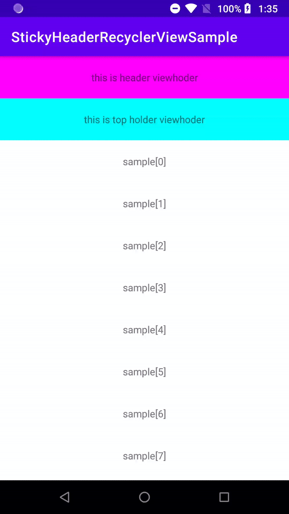

# StickyHeaderRecyclerViewSample

**KO** 외부 라이브러리 없이 `RecyclerView.ItemDecoration`만으로 Sticky Header를 구현한 샘플입니다.
**EN** A sample that implements a sticky header in `RecyclerView` using only `RecyclerView.ItemDecoration`, with no external library.

> 📖 **Blog / 블로그** · [Android Sticky Header RecyclerView](https://dnight.tistory.com/entry/Android-Sticky-Header-RecyclerView) (2021.06)
> **KO** `StickyHeaderItemDecoration` 전체 코드와 동작 설명이 글에 있습니다.
> **EN** The full `StickyHeaderItemDecoration` code and a walkthrough are in the post.

<!-- TODO: 블로그의 데모 GIF를 내려받아 docs/demo.gif 로 저장한 뒤 아래 주석을 해제하세요.
     블로그 이미지 주소는 만료될 수 있어 직접 링크하지 않는 것을 권장합니다.
     Save the blog's demo GIF as docs/demo.gif and uncomment below. Blog image URLs may expire, so don't hotlink them.

-->

---

## How it works / 동작 방식

**KO**
1. `onDrawOver`에서 RecyclerView **위에** 헤더를 덧그립니다.
2. 콜백(`SectionCallback`)으로 현재 맨 위 아이템의 헤더 뷰와, 헤더 여부를 받습니다.
3. 다음 헤더가 닿으면 `moveHeader`로 밀어 올리고, 아니면 `drawHeader`로 항상 맨 위에 고정해서 그립니다.

**EN**
1. `onDrawOver` draws the header **on top of** the RecyclerView.
2. A `SectionCallback` provides the header view for the top item and tells whether a position is a header.
3. When the next header touches it, `moveHeader` pushes it up; otherwise `drawHeader` pins it to the top.

---

## Usage / 사용법

```kotlin
interface SectionCallback {
    fun isHeader(position: Int): Boolean
    fun getHeaderLayoutView(list: RecyclerView, position: Int): View?
}
```

```kotlin
recyclerView.addItemDecoration(
    StickyHeaderItemDecoration(object : StickyHeaderItemDecoration.SectionCallback {
        override fun isHeader(position: Int): Boolean = adapter.isHeader(position)
        override fun getHeaderLayoutView(list: RecyclerView, position: Int): View? =
            adapter.getHeaderView(list, position)
    })
)
```

> **KO** `isHeader` / `getHeaderView`는 예제 앱의 [`SampleAdapter.kt`](app/src/main/java/dev/dnights/stickyheaderrecyclerviewsample/SampleAdapter.kt)에 구현되어 있고, 등록하는 코드는 [`MainActivity.kt`](app/src/main/java/dev/dnights/stickyheaderrecyclerviewsample/MainActivity.kt)에 있습니다.
> **EN** `isHeader` / `getHeaderView` are implemented in the sample's [`SampleAdapter.kt`](app/src/main/java/dev/dnights/stickyheaderrecyclerviewsample/SampleAdapter.kt), and the decoration is registered in [`MainActivity.kt`](app/src/main/java/dev/dnights/stickyheaderrecyclerviewsample/MainActivity.kt).

---

## Files / 파일

| File | Description |
|---|---|
| [`StickyHeaderItemDecoration.kt`](app/src/main/java/dev/dnights/stickyheaderrecyclerviewsample/StickyHeaderItemDecoration.kt) | **KO** 핵심 ItemDecoration · **EN** The core ItemDecoration |
| [`SampleAdapter.kt`](app/src/main/java/dev/dnights/stickyheaderrecyclerviewsample/SampleAdapter.kt) | **KO** 헤더 여부와 헤더 뷰를 제공하는 어댑터 · **EN** Adapter that tells which items are headers and provides the header view |
| [`MainActivity.kt`](app/src/main/java/dev/dnights/stickyheaderrecyclerviewsample/MainActivity.kt) | **KO** RecyclerView에 ItemDecoration 등록 · **EN** Registers the ItemDecoration on the RecyclerView |
| [`ListItemData.kt`](app/src/main/java/dev/dnights/stickyheaderrecyclerviewsample/ListItemData.kt), [`SampleData.kt`](app/src/main/java/dev/dnights/stickyheaderrecyclerviewsample/SampleData.kt) | **KO** 목록 데이터 · **EN** List data |

---

## Requirements / 요구사항

- minSdk 21, compileSdk/targetSdk 30
- AndroidX `RecyclerView` (**KO** `com.google.android.material:material:1.3.0`을 통해 포함 · **EN** pulled in via `com.google.android.material:material:1.3.0`)

---

## References / 참고 링크

- [Sticky Header RecyclerView 응용하기](https://leveloper.tistory.com/198)
- [Sticky Header Recyclerview using ItemDecoration without library](https://dailylonnie0125.tistory.com/22)
- [RecyclerView - StickyHeader](https://jhpop.tistory.com/152)

---

## 📚 More on the blog / 블로그에서 더 보기

- **KO** 안드로이드 UI·아키텍처 글은 [Android 카테고리](https://dnight.tistory.com/category/Android)에서 볼 수 있습니다.
- **EN** More Android UI and architecture posts are in the [Android category](https://dnight.tistory.com/category/Android).
- [Modern Android App Architecture](https://dnight.tistory.com/entry/Modern-Android-App-Architecture)
